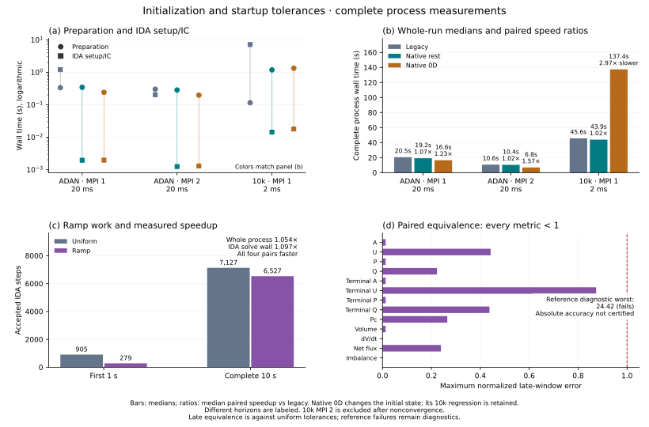

# Initial conditions and a fast startup interval

The executable prepares a consistent pair `(y0, ydot0)` before calling the IDA
wrapper. It checks the native residual collectively and uses IDA's `none`
correction mode only after this check succeeds. `Initial condition policy = IDA`
retains an explicit IDA-correction path and honors the selected IDA correction
mode. Selecting `none` also requires native pair preparation. Failure to prepare
an admissible, consistent pair stops the run.

```text
subsection MetricFlowSystem<1, 3>
  set Initial state source = steady network
  set Initial condition policy = native
  set Initial consistency tolerance = 0.01
  set Initial consistency maximum iterations = 30
  set Check Jacobian at startup = false
  set Maximum IDA internal steps per output = 500
end
```

`Initial state source = rest` remains the default physical seed. `steady network`
changes that seed, so its early trajectory need not agree with a simulation
started at rest. Under the native policy, both seeds use the same consistency
checks. Console verbosity
no longer enables the expensive finite-difference Jacobian diagnostic; enable
`Check Jacobian at startup` explicitly when needed.

`Maximum IDA internal steps per output` is a positive work limit for each
`IDASolve` call; its default of 500 preserves the native IDA default. Increasing
it permits more internal steps without changing error tolerances. Native IDA
errors stop the runner before a failed initial pair or integration interval is
written, including with Release deal.II libraries.

The compatibility guard uses IDA's differential-component setup hook to install
its error handler before `IDACalcIC`. The selected correction mode, reset mode,
or algebraic-error policy must enable that hook. The default reset mode does so
for both initial-condition policies; unsupported SDK-hook configurations are
rejected before integration. Diagnostics identify the error-handler code and
operation, which may differ from the return code hidden by the wrapper.

The tested deal.II 9.8/SUNDIALS 6.7 built-in vector-tolerance setup and
`CalcIC` also have an empty-MPI-rank minimum-vector defect. The enabled ramp
avoids the vector-setup path; verified native initialization avoids `CalcIC`.
Do not infer empty-rank support for the retained built-in/IDA-correction paths
from the native-pair and custom-weight MPI tests.

## The static 0D seed

Before mesh refinement, retain the original graph's vertex and coarse-cell
identities. At the configured initial time, solve a sparse resistive network for
nodal pressures and oriented edge flows. For the implemented friction profile,

$$
R_e=\frac{2(\xi+2)\mu}{\pi}\int_e\frac{ds}{r(s)^4},\qquad
Q_e=\frac{p_i-p_j}{R_e}.
$$

The fixed reference geometry is the same `a_d` or linear-radius taper used by
the 1D model. For `xi = 2`, this is Poiseuille's `8 mu L / (pi r^4)`. The tapered
integral is analytic. Resistances have units Pa·s/m³, pressures Pa, and flows
m³/s. Configured inlet flow is evaluated at `t0`, including tabulated inflow.
Each connected component must have a pressure reference through an RCR terminal;
cycles, parallel edges and separately anchored components are supported.

This mode requires positive viscosity and resistive RCR terminal conditions.
Use the existing VTK or parameter/CSV terminal source. The steady outlet relation
is `p = P_out + (R1+R2) Q`; initialize `Pc = P_out + R2 Q` when `C > 0`, and
allocate no capacitor state when `C = 0`. Missing anchors, invalid resistances,
nonfinite data and an inadmissible pressure-to-area inverse are errors.

Interpolate pressure according to accumulated resistance, invert the configured
compliant tube law including the current external pressure, and set nodal
velocities to `Q/A`. Preserve branch discontinuities and the native orientation.
The graph uses input coarse identities and straight-cell geometry; an external
mesh owner must preserve this correspondence.

This rigid pressure-continuity graph is a warm start. It does not solve the full
compliant HDG equations or the nonlinear total-head junction conditions.

## Native consistency and the first step

With cell and capacitor states fixed, solve the actual algebraic equations.
For elastic walls their Jacobian separates into small face/junction blocks, including duplicate
trace-continuity rows. The correction factors these blocks instead of pinning
all differential rows and factorizing a full-system matrix. Backtracking keeps
areas positive and requires a decreasing residual.

Each equation is scaled by its trace-Jacobian sensitivity to the configured
final IDA state weights, `atol_j + rtol*abs(y_j)`. Thus flow, pressure and
continuity equations are checked in their own units. The default consistency
threshold is 0.01 of this weighted scale; it is separate from the startup ramp.

For elastic walls, reconstruct cell derivatives from the existing inverse mass blocks and capacitor
derivatives from `C*Pc_dot = Q - (Pc-P_out)/R2`. Algebraic derivatives are zero;
they do not enter the DAE residual. Check the complete `F(t0,y0,ydot0)` again,
including the mass-inverted differential defect over the initial step divided
by the final IDA state weights. Both scaled maxima must satisfy the configured
consistency threshold. Nonfinite states, derivatives, residuals and weights are
rejected collectively, including ranks without cells.

Library clients can call `initialize_consistent_state(y, ydot, t0)` directly.
`initialize_state` alone prepares a state; it does not supply a consistent pair.

The serial `test_consistent_initialization` also passes the verified pair to
real `IDACalcIC`: state corrections and step-scaled derivative corrections must
stay below one final tolerance weight, with at most two Newton iterations and
no backtracking or convergence failures. SUNDIALS performs two weight passes,
so even a consistent pair can require two Jacobian setups and initial linear
solves. The test then requires a prescribed small first step (`1e-8` seconds)
to be accepted without error-test or convergence failures. It covers rest and
0D seeds, degrees one/two and resistive/capacitive RCR outlets, with nonzero
initial time and external pressure. Perturbed traces provide a negative control
that must be corrected. Consistency does not guarantee acceptance of an
arbitrarily large first step.

## Native viscoelastic consistency

With `Viscoelastic wall = true`, the same native policy prepares a consistent
pair without `IDACalcIC`. The Kelvin–Voigt stress contains $\nu(A)\dot A$, so
pressure-closure equations couple traces to cell-area rates. Those rates also
depend on traces through continuity: independent face/junction solves and a
subsequent inverse-mass reconstruction would omit this coupling.

Let $P_a$ select algebraic traces and $P_d$ select cell/capacitor variables.
Keep $P_d y_0$ fixed at the physical seed, set $P_a\dot y_0=0$, and solve

$$
F(t_0,y_0,\dot y_0)=0,\qquad
J_{IC}=F_yP_a+F_{\dot y}P_d/h_0.
$$

The unknown combines $P_a y$ with $h_0P_d\dot y$, where $h_0$ is the initial
step size (or the existing consistency time horizon when that size is zero).
An elastic trace correction and mass-only derivative reconstruction provide a
predictor; the complete viscous residual must still pass the final bounds.
The implementation selects columns from the existing analytic state and rate
Jacobians; it does not approximate $F_{\dot y}$ by the block mass matrix.
Physical column scales and equation sensitivity to final IDA error weights
normalize the global sparse Newton system. It uses `Use direct solver` and the
existing backend-specific direct or preconditioned GMRES solvers. Direct MPI
solves with PETSc require MUMPS, as in the time integrator; otherwise select the
iterative solver. No dense network-sized matrix is gathered to a root rank.

Backtracking requires a decreasing complete scaled residual and finite positive
areas with positive elastic wave-speed modulus. The final check uses the same
algebraic and mass-normalized differential defect bounds as the elastic
initializer. Differential seed values remain unchanged; algebraic time
derivatives remain zero. Exhausted iterations or failed admissibility/consistency
checks stop the run before time integration.

`test_native_viscoelastic_initialization` checks arterial, venous and mixed
arterial/venous/dural networks, degrees one and two, direct and iterative solves,
nonzero inflow/external pressure, the full residual, the fixed seed and the
zero-viscosity limit against the elastic initializer. MPI cases include ranks
without owned cells. Integration tests inspect the initial diagnostics to ensure
that native runs perform no IDA initial-condition residual or linear solves,
and compare native trajectories with explicit IDA correction on nonempty ranks.

## Looser tolerances during discarded startup

The optional ramp changes error weights while keeping the IDA history. The
configured IDA relative and absolute tolerances are the final values. Absolute
multipliers also apply to componentwise tolerances.

```text
subsection MetricFlowSystem<1, 3>
  set Use componentwise absolute tolerances = true
  set Tolerance ramp enabled = true
  set Tolerance ramp initial relative factor = 1000
  set Tolerance ramp initial absolute factor = 100
  set Tolerance ramp hold duration = 0.1
  set Tolerance ramp end time = 1.0
end
```

Hold duration is measured from `t0`; end time is an absolute simulation time.
After the hold, multipliers decrease geometrically to one. They must be finite
and at least one. The end must follow the hold, precede or equal final time, and
lie on the **IDA callback grid**, configured by `Time interval between each
output`. This is distinct from the file-output cadence. A stop at the cutoff
prevents an internal step with loose controls from crossing into the final
interval. Subsequent integration uses the original final controls.

Use componentwise tolerances for mixed area/velocity/pressure units; a large
scalar absolute tolerance can be inappropriate for small vessel areas. Set the
ramp end before the physical analysis window, leaving time for startup errors
to decay. Tight final local error controls do not by themselves remove a
previously accumulated transient. Validate the final window against a uniformly
tight run with the same initial state and forcing.

The adapter installs one custom error-weight function before initial IDA setup.
It neither resets IDA nor repeats `CalcIC` at ramp changes. It also avoids
switching a live custom-weight solve back to scalar/vector setters, which left
weight userdata stale in the tested SUNDIALS 6.7 build.
An enabled ramp requires the wrapper's differential-component setup hook:
`use_y_diff` for initialization/restart, or ignoring algebraic error terms.
Unsupported hook configurations are rejected explicitly. The default ramp is
disabled and leaves the built-in tolerance callbacks unchanged.

`initialization_statistics.json` reports preparation, IDA setup/IC, the first IDA
output-callback interval, initial-correction callback counts, native consistency
norms and ramp counters. Phase times are measured on rank zero. The first
interval excludes the initial output write; it is not the first internal BDF
step. Existing `ida_internal_steps.csv` and `ida_step_history.csv` record step
sizes and solver work. Whole-process measurements must also include mesh input,
setup, output and teardown.

## Reproducing the long-run comparison

The Linux/OpenMPI benchmark tools prepare a one-cell, degree-one case with a
sinusoidal inlet, a 0D/native initial pair and scalar final tolerances. It sets
`Maximum IDA internal steps per output = 10000` identically in every run: the
tighter reference exceeded the SDK default of 500. This changes a work cap, not
error tolerances. The
[default policy](../tools/ida_ramp_policy.json) fixes the 10-second run and checks
`[9,10]`. Acceptance measures the change introduced by the ramp relative to an
otherwise identical uniform-tolerance run: all 13 observables in every pair must
differ by strictly less than their final solver-weight budgets. Pressure, flow,
capacitor pressure and mass bounds are propagated from the final state
tolerances. The comparator reuses the tracked physical-unit helper and verifies
its policy-recorded hash.

The tighter-tolerance run provides accuracy diagnostics; neither production
configuration met a one-weight global-error bound against it in the v3 pilot.
That pilot remains failed, with all its timings excluded. After inspecting that
failure, v4 narrowed acceptance to baseline equivalence before fresh formal
measurements, without changing numerical bounds, tolerances, inputs or grids.
All tighter-run comparisons, including failed metrics, remain in the report;
finite data, complete grids and valid physical inputs are mandatory for every
run. This tests the sampled late window of this single-cell fixture and does
not certify absolute trajectory accuracy. The tighter run is not an exact or
verified converged solution.

Prepare and inspect the input files before execution:

```sh
python3 tools/benchmark_ida_ramp.py --executable build/blood_flow \
  --output /tmp/ida-ramp-pilot --pilot
python3 tools/benchmark_ida_ramp.py --executable build/blood_flow \
  --output /tmp/ida-ramp-pilot --pilot --execute
```

The pilot has uniform, ramped and tighter-reference runs; all pilot timings are
excluded from formal performance. After its physical checks pass, use a fresh
output directory without `--pilot` for four balanced uniform/ramp pairs and one
excluded tighter reference. Raw logs, effective inputs, all timings and all
physical comparisons remain in the output directory; an executed directory
cannot be reused.

`--source` defaults to the checkout containing the tools. Use `--policy` for a
separately declared configuration, `--mpirun` for a launcher outside `PATH`,
`--map-by` for an available physical core, and `--library-directory` when the
matching library is not beside the executable. Placement, actual affinity,
quiet-core preflight and executable/library hashes are recorded. No wall-clock
threshold is imposed by ordinary tests.

The physical comparison can also be rerun without launching the solver:

```sh
python3 tools/compare_late_ramp_outputs.py \
  --before /tmp/ida-ramp-pilot/reference --after /tmp/ida-ramp-pilot/ramp-0 \
  --output /tmp/ida-ramp-comparison.json
python3 -m unittest discover -s tests -p test_late_ramp_outputs.py
```

## Measured startup and complete-run costs



[Final samples and validation](performance_data/initialization/results.json)
retain all 27 initialization runs and nine ramp runs. Three cyclic triplets
balance each initialization policy's order. Comparisons use identical compiler
flags and corrected linear solvers on each host: the
[legacy reference](https://github.com/luca-heltai/metric-flow-x/tree/codex/initialization-reference)
retains the old initialization. Mesh input, setup, output and teardown are
included in complete-process times. These short network runs measure startup;
the separate ramp experiment runs for 10 seconds.

Initialization total is preparation plus IDA setup/IC, calculated per run.
Times below are medians; speed ratios are medians of same-host paired ratios.

| Case / horizon | MPI | Policy | Initialization total (s) | Complete process (s) | IDA steps |
|---|---:|---|---:|---:|---:|
| ADAN / 20 ms | 1 | Legacy | 1.5457 | 20.520 | 475 |
| ADAN / 20 ms | 1 | Native rest | 0.3467 | 19.165 | 475 |
| ADAN / 20 ms | 1 | Native 0D | 0.2442 | 16.559 | 288 |
| ADAN / 20 ms | 2 | Legacy | 0.5067 | 10.644 | 475 |
| ADAN / 20 ms | 2 | Native rest | 0.2853 | 10.392 | 475 |
| ADAN / 20 ms | 2 | Native 0D | 0.1990 | 6.833 | 288 |
| 10k / 2 ms | 1 | Legacy | 7.2786 | 45.584 | 59 |
| 10k / 2 ms | 1 | Native rest | 1.1991 | 43.880 | 60 |
| 10k / 2 ms | 1 | Native 0D | 1.3527 | 137.377 | 353 |

Native rest removes `CalcIC`: its initialization total improves 6.07 times on
10k, with a modest complete-process gain of 1.019 times. ADAN complete-process
ratios are 1.071 (MPI 1) and 1.024 (MPI 2). The 0D seed changes the physical
initial state: it helps ADAN, but makes this 10k run 2.97 times slower. **Rest
remains the default.** The tested 10k two-rank iterative solve did not converge
and has no accepted performance samples.

All four ramp pairs pass the 13 late-window comparisons against uniform
controls. Median paired gains are 1.054 times for the complete process and
1.097 times for IDA solve wall, including callbacks. Steps fall from 905 to 279
through 1 second and from 7,127 to 6,527 over 10 seconds. The tighter-run global
accuracy diagnostics still fail, with a worst normalized difference of 24.42;
these results certify the stated baseline equivalence only.

Final native-rest comparisons pass all 11 single-vessel quantities (maximum
normalized difference 0.006193). Network checks cover exported midpoint area,
velocity and flow only: 77 ADAN midpoints at one/two ranks and 20,001 midpoints
on 10k at one rank pass, with the largest normalized difference 0.216. This does
not certify complete-field, pressure/capacitor or network conservation
identity. All-time single-vessel equality fails at the initial trace: legacy
outlet flow is about `8.87e-13 m^3/s`, while native rest gives zero with the same
initial cell state. Initial and final comparison scopes remain separate.

The shared [ADAN](performance_data/initialization/adan56.prm) and
[10k](performance_data/initialization/network10k.prm) input templates retain the
measured physical and solver controls with portable mesh paths. Download large
meshes with `scripts/download_datasets.sh`. Build the reference and candidate
with the same compiler/backend, then use
[`benchmark_initialization.py`](../tools/benchmark_initialization.py) with
`--preserve-reference-tolerances`, the selected horizon and file cadence.
Execution requires explicit host-specific `--mpi-command` and `--rank-cpus`;
`--open-file-limit 32768` supplies the measured descriptor capacity for the
20,001-edge tree without changing the host's hard limit.

Recreate the figure from the retained final data:

```bash
python3 tools/plot_initialization_results.py \
  --input doc/performance_data/initialization/results.json \
  --output /tmp/initialization_comparison.svg
```

Related design discussion: [#25](https://github.com/luca-heltai/metric-flow-x/issues/25),
component scaling [#14](https://github.com/luca-heltai/metric-flow-x/issues/14),
linear-solver lifecycle [#26](https://github.com/luca-heltai/metric-flow-x/issues/26).
