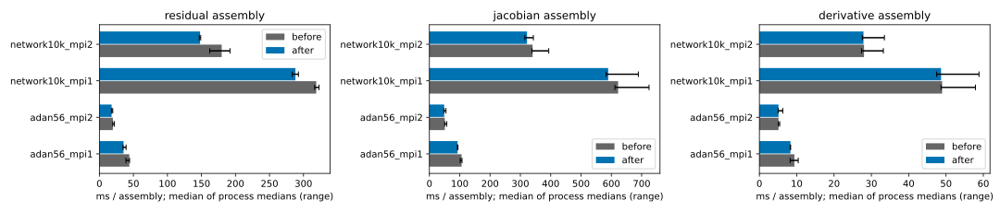
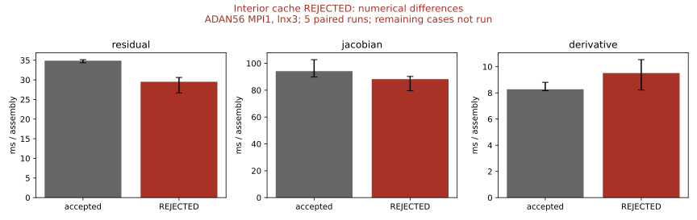
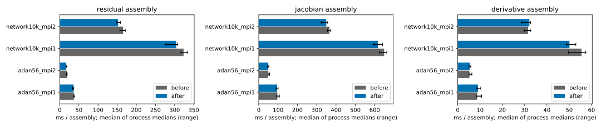
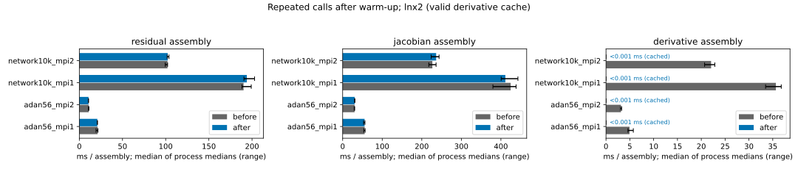
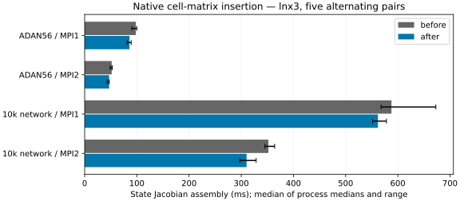

# Measured performance campaign

The five-intervention campaign is tracked in
[issue #36](https://github.com/luca-heltai/metric-flow-x/issues/36), following the
assembly investigation in issue #9. Each accepted intervention has a separate
pull request based on the preceding intervention. Candidates must demonstrate
an improvement and preserve the measured numerical results.

```{toctree}
:hidden:
:glob:
:maxdepth: 1

performance_data/*/README
```

## Measurement and numerical comparison

`benchmark_assembly` measures setup, residual assembly, the state Jacobian, and
the derivative Jacobian separately. Three timed samples follow a warm-up. Each
sample reports elapsed time per call on the slowest MPI rank. The benchmark
does not solve a circulation trajectory or include physical output costs.

An optional third argument supplies a snapshot filename prefix. After timing,
the benchmark assembles three nonuniform states at different times, including
reversed velocity, and writes every locally owned residual entry and every
stored entry of both Jacobian matrices as hexadecimal doubles. Comparisons use
the same MPI process count and numbering before and after an intervention.
Neither a norm nor a weighted checksum alone is the acceptance criterion.

`tools/compare_assembly.py` runs archived before/after executables and libraries
in alternating order with one OpenMP/OpenBLAS thread and MPI processes bound
to cores. It checks exact snapshot equality and records the hashes and sizes
before removing the large snapshot files. It preserves raw JSON timing records,
command lines, build/input hashes, host and CPU metadata, process logs, and SVG
and PNG comparison plots. Plot error bars show the range of independent process
medians, not a confidence interval. Timing is a local experiment, not a CI gate.

To archive a build, copy `benchmark_assembly` and `libmetric_flow_x.so` into a
directory and add a `revision.txt` describing the source revision and any
uncommitted source hash. Archive before rebuilding. `LD_LIBRARY_PATH` selects
the corresponding library; confirm the selection with `ldd` on Linux. Use the
same measurement driver in both archives.

```sh
python3 tools/prepare_assembly_benchmarks.py \
  --adan56-mesh notebooks/56_adnr_new.vtk \
  --network10k-mesh notebooks/networks_by_svv/trees/network_10000_adnr.vtk \
  --output-dir build/performance_campaign/inputs
python3 tools/compare_assembly.py \
  --before build/performance_campaign/baseline \
  --after build/performance_campaign/candidate1 \
  --inputs build/performance_campaign/inputs/adan56.prm \
           build/performance_campaign/inputs/network10k.prm \
  --ranks 1 2 --runs 5 --repetitions 20 \
  --output build/performance_campaign/step1
```

The reporting script requires matplotlib. The solver and its tests do not.
Keep working artifacts on persistent storage when execution may move between
nodes. Do not combine timings from different machines into a paired comparison.

Full trajectory regressions, finite-difference Jacobian tests, external-pressure
oracles, taper tests and MPI tests complement these synthetic snapshots. Exact
agreement on finite workloads does not establish all possible configurations
or physiological validity. Assembly speedups and end-to-end speedups must be
reported separately.

## Intervention 1: reuse local cell state

The cell residual and cell Jacobian previously extracted distributed DoF values
separately for each component, volume and face. They now extract once per cell
and use deal.II's existing `get_function_values_from_local_dof_values()` path.
No interpolation formula, quadrature, flux, or accumulation order is changed.
The numerical source is commit `6c2e6f8`, compared with main `b5d1b62`; both
archives use the same extended benchmark driver.

The accepted experiment ran on lnx3 with GCC 13.2.0, deal.II 9.8.0, PETSc,
Release (effective `-O2`, AVX2), and five alternating process pairs per case. Each process
uses three timed samples of 20 residual calls. The ADAN56 workload has degree 2,
2464 cells and 24671 unknowns; the SI network has degree 1, 20001 cells and
170009 unknowns. The preliminary lnx2 data are excluded.

| Case | Before residual (ms) | After residual (ms) | Median paired speedup |
|---|---:|---:|---:|
| adan56_mpi1 | 43.962 | 35.506 | 1.124 |
| adan56_mpi2 | 19.806 | 17.974 | 1.111 |
| network10k_mpi1 | 318.719 | 288.133 | 1.107 |
| network10k_mpi2 | 179.748 | 148.003 | 1.224 |

Times are medians of process medians. The paired speedup is the median of the
five before/after ratios, which differs from the ratio of independently taken
medians. Every residual pair improved. The state-Jacobian paired medians improved
by 1.141x/1.047x for ADAN56 MPI1/MPI2 and 1.053x/1.074x for the SI network.
The derivative Jacobian is unchanged code and serves as a variability control:
its ADAN56 MPI1 samples drifted appreciably, while the other three paired
medians are approximately 1.0. No derivative-Jacobian speedup is claimed.



The [raw records](performance_data/01_local_state/timings.jsonl),
[environment and binary hashes](performance_data/01_local_state/metadata.json),
[input manifest](performance_data/01_local_state/inputs.json), and
[exact comparison receipts](performance_data/01_local_state/equivalence.json)
are committed alongside the figure. All 54 snapshot pairs matched exactly,
covering 1,179,248,416 bytes of residual and matrix data on each side.
The seven focused Release tests passed: coupling readiness, external pressure,
cell Jacobian, taper, terminal parameters, mesh initializer and constant reload.
These tests include independent analytical and finite-difference oracles.
The [test log](performance_data/01_local_state/release_tests.log) records the
actual selection and result.

Both archives also passed the existing analytic/CSV inflow integration check
at MPI1 and MPI2 through 0.01 s with nonzero flow. Direct comparison between
the archives matched all 32 output CSVs (2372 rows) exactly after removing only
`scaling_timings.csv` and the `wall_time` statistics field. Physical time columns
were retained. The [trajectory receipt](performance_data/01_local_state/trajectory_equivalence.json)
records the compared files and row hashes. This is a short numerical regression,
not a full cardiac-cycle validation or an end-to-end timing claim.

## Rejected candidate: cache interior-face traversal

Candidate `6b52f26` cached the interior-face traversal and trace indices. Its
26 Release tests passed, including mesh reconstruction and empty MPI ranks,
but the exact ADAN56/MPI1 gate failed in all three nonuniform states. The
residual differed by at most 5.33e-15 and the state Jacobian by 3.73e-9.
The derivative matrices remained identical. No tolerance was substituted.

Inspection of the archived machine code confirmed that GCC changed the FMA
contraction order in tangent-normal products after the refactoring. The
[diagnosis](performance_data/rejected_interior_cache/diagnosis.txt) records
the instructions and the limits of the source-level traversal audit.
The candidate remains excluded from the accepted stack. Only ADAN56/MPI1
completed the five timing pairs; the other cases were not run after rejection.



The [exact mismatch receipt](performance_data/rejected_interior_cache/rejection.json),
[partial timings](performance_data/rejected_interior_cache/timings.jsonl), and
[binary metadata](performance_data/rejected_interior_cache/metadata.json)
preserve the failed experiment. Its timing improvement is not an accepted
performance intervention.

## Intervention 2: transfer owned FE state in bulk

`update_ghosted_vectors()` previously read and inserted one distributed vector
entry at a time. It now uses the existing native subvector extraction and bulk
insertion interfaces. The ownership validation, insertion compression and both
ghost imports retain their original order. No floating-point formula changes.
The measured source patch is archived against `965e7fd`; the final numerical
source is `2042e28`, which also includes the separate CTest build-lock fix.

The same lnx3 protocol as intervention 1 ran five alternating pairs for all
four cases. Eighteen of twenty residual pairs improved. The state Jacobian also
uses the changed ghost import, but its benefit is smaller and partly masked by
process variability. The derivative Jacobian is unchanged and remains a
variability control. No end-to-end speedup is claimed.

| Case | Before residual (ms) | After residual (ms) | Median paired speedup |
|---|---:|---:|---:|
| adan56_mpi1 | 36.915 | 36.169 | 1.076 |
| adan56_mpi2 | 18.408 | 16.913 | 1.068 |
| network10k_mpi1 | 323.397 | 304.148 | 1.063 |
| network10k_mpi2 | 165.504 | 152.524 | 1.068 |



All 54 snapshot pairs matched exactly, covering 1,179,248,416 bytes per side.
The [receipts](performance_data/02_bulk_vectors/equivalence.json),
[raw timing records](performance_data/02_bulk_vectors/timings.jsonl),
[build metadata](performance_data/02_bulk_vectors/metadata.json) and
[input hashes](performance_data/02_bulk_vectors/inputs.json) accompany the plot.
Rounded TimerOutput summaries show an approximately sixfold reduction in the
ghost-update section; the [profile receipt](performance_data/02_bulk_vectors/ghost_profile.json)
records these approximate section times separately from the assembly benchmark.

All 25 Release tests passed, including build, execution and output comparison.
CTest also passed with `-j4` after verifying the shared build lock on every
discovered test. This additionally validates the supporting fix in PR #38.
Both measured archives passed the analytic/CSV inflow check at MPI1 and MPI2;
all 32 physical output CSVs (2372 rows) matched exactly after excluding only
scaling timings and the wall-clock statistics field. The
[test log](performance_data/02_bulk_vectors/release_tests.log) and
[trajectory receipt](performance_data/02_bulk_vectors/trajectory_equivalence.json)
record these checks.

The [compiler flags](performance_data/02_bulk_vectors/toolchain.json) are the
same before and after. Although CMake's Release flags begin with `-O3`, the
configured deal.II flags subsequently append `-O2`; the effective optimization
level is therefore `-O2`. This also corrects the earlier description of
intervention 1, which used the same flags.

After the whitespace cleanup for publication, the final source was recompiled
and independently checked against all 54 recorded snapshot hashes. The final
executable also reproduced all 32 trajectory CSVs exactly. Separate
[final-revision receipts](performance_data/02_bulk_vectors/final_revision_equivalence.json)
and [trajectory receipts](performance_data/02_bulk_vectors/final_trajectory_equivalence.json)
identify the recompiled library; the original timed build remains archived.

## Intervention 3: reuse the derivative Jacobian

The derivative Jacobian depends on mesh mass matrices and terminal
capacitances, rather than the supplied time or state. It now reuses its
existing assembled matrix. Parameter reload, sparsity reconstruction and mass
reconstruction invalidate the cache. The first call after invalidation retains
the original assembly sequence; no additional matrix is allocated.

Both cumulative builds, `2042e28` before and `7908e4f` after, were compiled and
measured on **lnx2** using five alternating pairs for ADAN56 and the 10k network
at MPI1/MPI2. The benchmark warms up each operation, so these measurements
represent repeated calls with a valid cache. The after values reach the cost of
a function call and cache lookup; no large speedup ratio or end-to-end solve
improvement is inferred from those nanosecond values.

| Case | Before derivative (ms) | Cached derivative (ms) |
|---|---:|---:|
| adan56_mpi1 | 4.937 | <0.001 |
| adan56_mpi2 | 3.137 | <0.001 |
| network10k_mpi1 | 35.659 | <0.001 |
| network10k_mpi2 | 22.058 | <0.001 |



All **54 snapshot pairs matched exactly**, covering 1,179,248,416 bytes per
side. Both archives passed the analytic/CSV inflow checks with MPI1/MPI2, and
all **32 trajectory CSVs (2372 rows)** matched exactly after excluding only
scaling timings and the wall-clock statistics field. The short 0.01 s trajectory
is a numerical regression, not a full cardiac-cycle simulation.

All **26 Release tests passed BUILD/RUN/DIFF and CTest**. The new regression
also passed with MPI2 and MPI4, including empty ranks. It verifies state
independence, the analytical factor-two mass change after scaling geometry,
and rebuilt mesh/terminal capacitance. The
[full report](performance_data/03_derivative_cache/README.md),
[snapshot receipt](performance_data/03_derivative_cache/equivalence.json),
[trajectory receipt](performance_data/03_derivative_cache/trajectory_equivalence.json),
[raw timings](performance_data/03_derivative_cache/timings.jsonl) and
[test log](performance_data/03_derivative_cache/release_tests.log) preserve the evidence.

The node was busy; host-load records and the unchanged residual/state-Jacobian
controls are included in the report. No improvement is claimed for those
controls. The measured candidate was rebased onto the published intervention-2
documentation without changing executable source, inputs, tools or tests; the
[tree-equivalence receipt](performance_data/03_derivative_cache/runtime_rebase_equivalence.json)
identifies both revisions. Exact measured inputs are retained as deterministic
`.prm.gz` files with decompression hashes checked against their manifest.

The subsequent indentation fix from PR40 passed full-file clang-format 16
checks on every changed C++ file. After rebuilding on lnx2, the shared library,
benchmark and driver were byte-identical to the measured candidate. The
[ELF equivalence receipt](performance_data/03_derivative_cache/formatting_binary_equivalence.json)
and [format check](performance_data/03_derivative_cache/formatting_check.json)
record this follow-up without changing numeric data.

## Intervention 4: insert cell Jacobians in bulk

The final cell Jacobian scatter now uses the existing native matrix block
insertion interface. The PETSc wrapper submits one local row per call while
retaining the original row/column order and zero filtering. Cell volume and
face arithmetic, trace insertion and compression retain their original order.

Both cumulative builds, `7908e4f` before and `7bfd570` after, were compiled and
measured on **lnx3** with five alternating pairs for ADAN56 and the 10k network
at MPI1/MPI2. Nineteen of twenty state-Jacobian pairs improved. Residual and
derivative timings remain controls; no end-to-end speedup is claimed.

| Case | Before state Jacobian (ms) | After state Jacobian (ms) | Median paired speedup |
|---|---:|---:|---:|
| adan56_mpi1 | 98.038 | 85.955 | 1.135 |
| adan56_mpi2 | 51.821 | 46.877 | 1.119 |
| network10k_mpi1 | 587.857 | 561.946 | 1.054 |
| network10k_mpi2 | 352.059 | 310.201 | 1.140 |



All **54 snapshot pairs matched exactly**, covering 1,179,248,416 bytes per
side. Both archives passed analytic/CSV inflow checks at MPI1/MPI2, with all
**32 trajectory CSVs (2372 rows)** identical after the same wall-clock
exclusions as earlier interventions. All **26 Release tests passed
BUILD/RUN/DIFF and CTest**. The
[full report](performance_data/04_matrix_bulk/README.md),
[exact snapshot receipt](performance_data/04_matrix_bulk/equivalence.json),
[trajectory receipt](performance_data/04_matrix_bulk/trajectory_equivalence.json),
[raw timings](performance_data/04_matrix_bulk/timings.jsonl) and
[test log](performance_data/04_matrix_bulk/release_tests.log) retain the evidence.

The runtime patch was rebased onto published intervention 3, inheriting only
declaration alignment in executable source. The entire changed source passed
clang-format 16; recompilation produced three ELF files byte-identical to the
measured candidate. The
[binary identity receipt](performance_data/04_matrix_bulk/formatting_binary_equivalence.json)
and [tree audit](performance_data/04_matrix_bulk/runtime_rebase_equivalence.json)
connect the measured build to the submitted runtime. Exact measured inputs are
archived as deterministic `.prm.gz` files with their decompression hashes.
