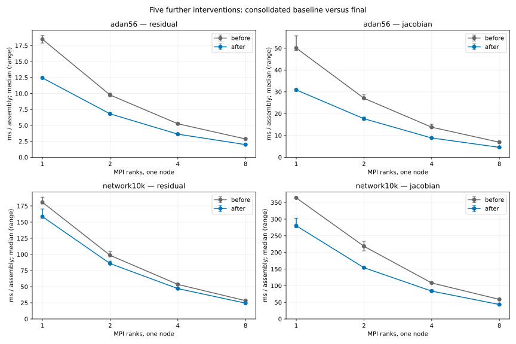
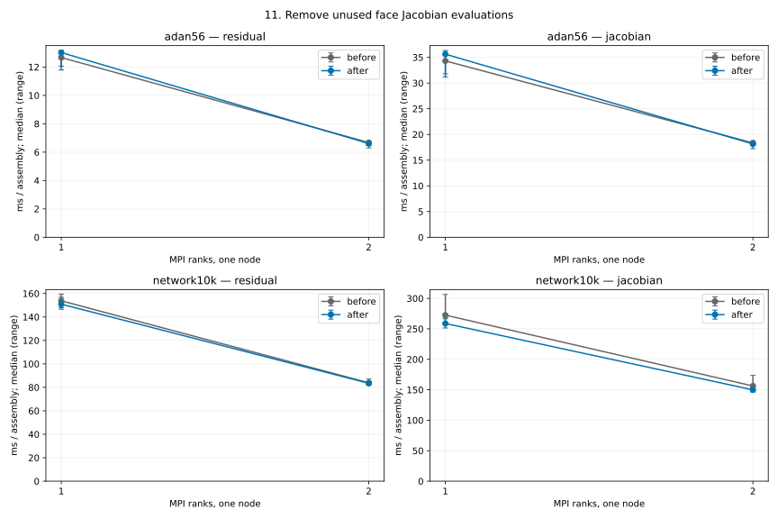
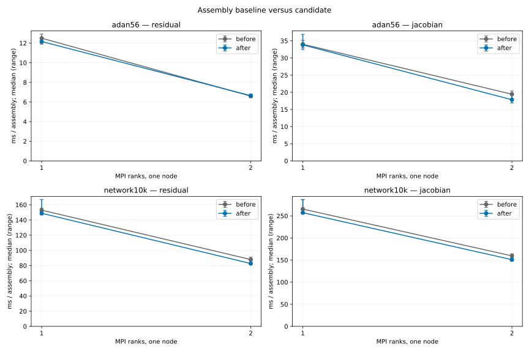
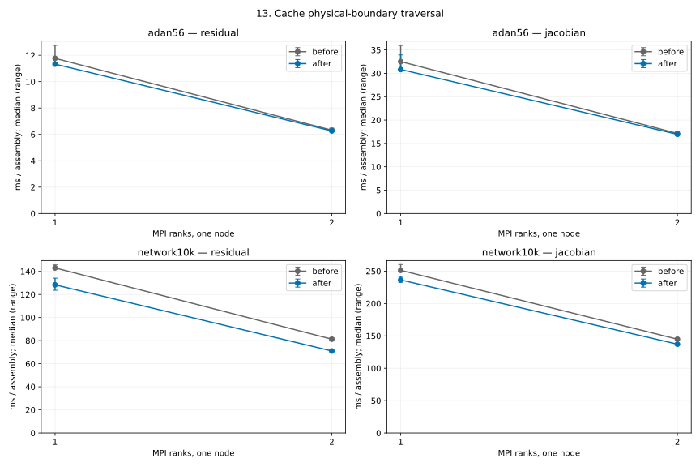

# Assembly performance

The first five changes reduce repeated assembly work: reuse each cell's local state;
transfer FE vectors in bulk; reuse the derivative Jacobian until setup, mass
or capacitance changes; insert cell matrices in bulk; gather/scatter residual
cell vectors in bulk. A CTest resource lock also prevents concurrent nested
Ninja writers.

The initial baseline and complete stack were rebuilt on **lnx3**, GCC 13.2,
deal.II 9.8/PETSc, Release (`-O2`, AVX2). Three alternating process pairs
measure ADAN56 and the SI 10k network at **MPI1/2/4/8**, with three warmed
samples per process. Median paired speedups are **1.20–1.34x** for the
residual and **1.13–1.26x** for the state Jacobian. Repeated valid-cache
derivative calls take less than 0.001 ms; first assembly is outside that timing.


All **270 complete residual/Jacobian snapshot pairs** and **32 physical CSVs
(2372 rows)** match exactly; the final runtime passes 26 Release regressions.
The CSV gate excludes execution-time diagnostics. At MPI8 final residual/
Jacobian efficiencies are **91.9%/93.4%** on ADAN56 and **85.7%/78.2%** on
the 10k network. Relative efficiency does not improve uniformly. These are
one-node assembly measurements and short trajectories, not full-cycle solver
or multi-node performance results. [Final results](performance_data/results.json)
retain medians, ranges, paired improvements and the measurement configuration.

## Reuse the measurement tools

`tools/prepare_assembly_benchmarks.py` prepares representative inputs. Archive
each `benchmark_assembly`, matching `libmetric_flow_x.so` and `revision.txt`
in separate before/after directories, then run:

```sh
python3 tools/prepare_assembly_benchmarks.py \
  --adan56-mesh /path/to/56_adnr_new.vtk \
  --network10k-mesh /path/to/network_10000_adnr.vtk --output-dir INPUTS
python3 tools/compare_assembly.py --before BEFORE --after AFTER \
  --inputs INPUTS/adan56.prm INPUTS/network10k.prm --ranks 1 2 4 8 \
  --runs 5 --repetitions 20 --output /tmp/assembly-comparison
python3 tools/plot_assembly_results.py \
  /tmp/assembly-comparison/results.json --output /tmp/assembly.svg
```

Plotting requires Matplotlib. Use `--map-by POLICY` to keep placement on
verified idle cores identical before and after.

The CLI budget `--repetitions 20` uses 20 residual/derivative and 2 state-Jacobian
assemblies per sample, with three samples and one untimed warmup per kernel.

Raw logs stay in the local output directory. Commit only the final summary
and figure. Exact snapshot comparison is the default; explicit `--rtol` and
`--atol` permit small floating-point errors in later experiments. Set the
criteria before measuring, report actual errors and verify physical trajectory
changes against the configured solver tolerances.

## Five further assembly changes (6–10)

Cache interior-face topology; gather face local state once; skip inactive FE
supports; reuse vessel material stiffness; reuse cell-Jacobian scratch storage.
Three alternating Release/PETSc pairs on lnx3 compare the consolidated first
five changes with this complete series at MPI1/2/4/8, with 20 repetitions and
verified idle cores. ADAN56 residual/Jacobian speedups are **1.43–1.49x /
1.52–1.62x**; the 10k network reaches **1.13–1.17x / 1.29–1.43x**.

All **270 complete snapshots match byte-for-byte** (109,327,968 entries),
under predeclared 64-epsilon local bounds. The cumulative 32-CSV physical
comparison stays strictly below unchanged solver-weight bounds
(`atol=1e-12`, `rtol=1e-7`), maximum normalized error **0.365**.
These are one-node assembly timings and short physical regressions.



[Final results](performance_data/06_10_overall/results.json) retain all pairs,
ranges, source/build provenance and completion details. Timings use revision
`72345a5`; this consolidation additionally includes the separately tested
square-root-law wave-speed derivative correction from PR #48.

For the scalar-IDA single-vessel inflow fixture, compare physical outputs with:

```sh
python3 tools/compare_inflow_trajectories.py --before BEFORE --after AFTER \
  --policy PREDECLARED.json --output REPORT.json
```

Record the policy before measuring. The tool checks unchanged effective inputs,
reads actual solver weights and propagates bounds in SI units. It rejects
unsupported componentwise tolerances and fixtures; no tolerance overrides exist.

Remaining assembly costs are cells/interior faces on ADAN56 and cells,
junctions/boundaries on the network. Full-solver startup, factorization and
output require separate measurements; see #9, #25 and #26.

## 11. Remove unused face-Jacobian evaluations

Remove unused interior-velocity extraction and wave-speed vectors from boundary
and junction Jacobians. Five alternating Release/PETSc pairs on lnx4 use
20 repetitions, three samples and verified idle cores 8/9 at MPI1/MPI2.
The 10k network Jacobian improves **1.053/1.067x**, with all **10 pairs** faster;
target junction scopes improve **1.117/1.108x**. ADAN56 Jacobians measure
**0.982/1.011x**: the MPI1 decrease tracks unchanged cell/interior controls
(**0.970/0.972x**). Tiny ADAN boundary scopes measure **0.953/0.975x**.
No uniform full-Jacobian or residual improvement is claimed.

All **54 snapshots** and **32 trajectory CSVs / 2372 rows** match exactly;
**29 Release regressions** and cache MPI2/MPI4 checks pass.
[Results](performance_data/11_unused_face_jacobian/results.json) retain all pairs,
ranges, controls and provenance.



## 12. Reuse junction assembly workspace

Reuse invocation-local per-vessel vectors across junctions; resize for each
junction and overwrite every active entry. Five alternating Release/PETSc pairs
on lnx3 use 20 repetitions, three samples and idle cores 8/9 at MPI1/MPI2.
The 10k network residual improves **1.028/1.052x**, Jacobian **1.025/1.052x**;
all five MPI2 pairs improve for both metrics. Junction residual scopes improve
**1.134/1.156x** and Jacobian scopes **1.074/1.107x** on that network.
ADAN56 overall residual/Jacobian ratios are **1.028/0.988x** at MPI1 and
**0.992/1.100x** at MPI2; unchanged controls also vary. All pairs, including
the slower network MPI1 pair, remain in the results.

All **54 snapshots** and fresh **32 trajectory CSVs / 2372 rows** match exactly;
**29 Release regressions** and MPI2/MPI4 cache/empty-rank checks pass.
[Results](performance_data/12_junction_workspace/results.json) include paired
measurements, controls, bounds and provenance. These are assembly timings.



## 13. Cache physical-boundary traversal

Rebuild physical-boundary cells, face numbers and canonical trace indices with
DoF setup, preserving traversal order. Boundary/RCR assembly reads current
geometry, labels, parameters and external pressure at each call.
Five alternating Release/PETSc pairs on lnx4 use verified idle cores 8/9,
MPI1/MPI2 and the CLI budget above. Network residual speedups are
**1.122/1.146x**, Jacobians **1.065/1.061x**, with all **20 pairs** faster.
Boundary residual/Jacobian scopes improve **1.42–1.90x / 1.27–2.41x**
(all **40 pairs**). ADAN residuals measure **1.049/1.007x** and Jacobians
**1.006/1.017x**; small changes vary with unchanged controls.

All **54 snapshots** and **32 trajectory CSVs / 2372 rows** match exactly;
**29 Release regressions**, cache MPI2/MPI4 and boundary-rebuild checks pass.
[Results](performance_data/13_boundary_topology/results.json) retain every pair,
controls and provenance, plus two bulk-Jacobian trials that were not promoted.
Their complete raw data remain local and separate.


