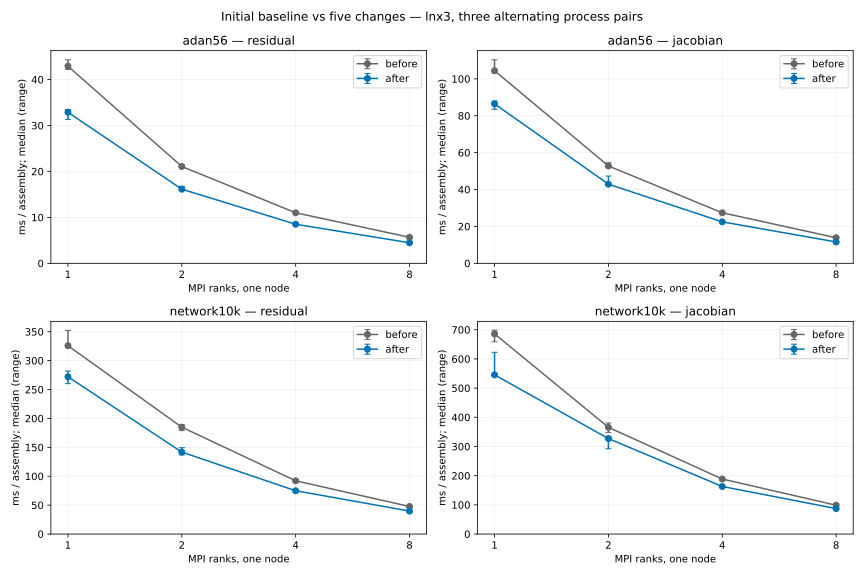
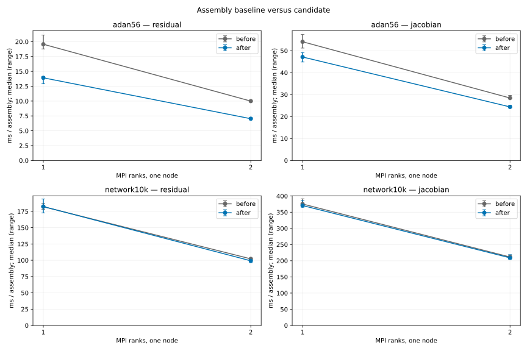
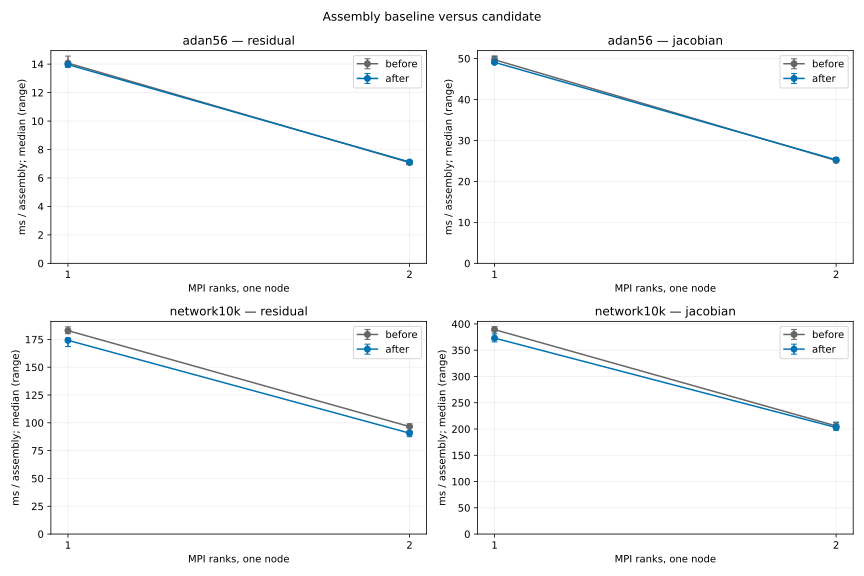

# Assembly performance

The first five changes reduce repeated assembly work: reuse each cell's local state;
transfer FE vectors in bulk; reuse the derivative Jacobian until setup, mass
or capacitance changes; insert cell matrices in bulk; gather/scatter residual
cell vectors in bulk. A CTest resource lock also prevents concurrent nested
Ninja writers.

The initial baseline and complete stack were rebuilt on **lnx3**, GCC 13.2,
deal.II 9.8/PETSc, Release (`-O2`, AVX2). Three alternating process pairs
measure ADAN56 and the SI 10k network at **MPI1/2/4/8**, with three warmed
samples per process. Median paired speedups are **1.20–1.34x** for the
residual and **1.13–1.26x** for the state Jacobian. Repeated valid-cache
derivative calls take less than 0.001 ms; first assembly is outside that timing.



All **270 complete residual/Jacobian snapshot pairs** and **32 physical CSVs
(2372 rows)** match exactly; the final runtime passes 26 Release regressions.
The CSV gate excludes execution-time diagnostics. At MPI8 final residual/
Jacobian efficiencies are **91.9%/93.4%** on ADAN56 and **85.7%/78.2%** on
the 10k network. Relative efficiency does not improve uniformly. These are
one-node assembly measurements and short trajectories, not full-cycle solver
or multi-node performance results. [Final results](performance_data/results.json)
retain medians, ranges, paired improvements and the measurement configuration.

## Reuse the measurement tools

`tools/prepare_assembly_benchmarks.py` prepares representative inputs. Archive
each `benchmark_assembly`, matching `libmetric_flow_x.so` and `revision.txt`
in separate before/after directories, then run:

```sh
python3 tools/prepare_assembly_benchmarks.py \
  --adan56-mesh /path/to/56_adnr_new.vtk \
  --network10k-mesh /path/to/network_10000_adnr.vtk --output-dir INPUTS
python3 tools/compare_assembly.py --before BEFORE --after AFTER \
  --inputs INPUTS/adan56.prm INPUTS/network10k.prm --ranks 1 2 4 8 \
  --runs 5 --repetitions 20 --output /tmp/assembly-comparison
python3 tools/plot_assembly_results.py \
  /tmp/assembly-comparison/results.json --output /tmp/assembly.svg
```

Plotting requires Matplotlib. Use `--map-by POLICY` to keep placement on
verified idle cores identical before and after.

Raw logs stay in the local output directory. Commit only the final summary
and figure. Exact snapshot comparison is the default; explicit `--rtol` and
`--atol` permit small floating-point errors in later experiments. Set the
criteria before measuring, report actual errors and verify physical trajectory
changes against the configured solver tolerances.

Remaining measured costs are interior-face work on refined ADAN56 and cell,
junction and boundary work on the 10k network. Setup sparsity construction,
bootstrap, output and solver factorization reuse need separate full-solver
measurements; see issues [#9](https://github.com/luca-heltai/metric-flow-x/issues/9),
[#25](https://github.com/luca-heltai/metric-flow-x/issues/25) and
[#26](https://github.com/luca-heltai/metric-flow-x/issues/26).

## 6. Cache interior-face topology

Cache interior-face traversal and trace indices after DoF distribution,
preserving row ownership; mesh/DoF rebuilds replace the cache. Pinning the
normal's FMA order avoids amplified roundoff in the trace Jacobian.

Five alternating Release/PETSc pairs on lnx3 compare MPI1/2 on free cores 8/9.
A predeclared full confirmation repeated all four cases after finding physical
core contention; both complete datasets remain local. ADAN56 paired speedups
are **1.42–1.46x residual** and **1.15–1.17x state Jacobian**. Network gains
are small/noisy (**1.01–1.03x**); no precise statistical bound is claimed.

All **54 snapshots** and **32 physical CSVs / 2372 rows** match exactly.
All **27 Release regressions**, cache-rebuild tests at MPI2/MPI4 with empty
ranks, and clang-format 16 pass. With declared 64-epsilon local bounds,
every measured numerical error is zero.
[Final results](performance_data/06_face_topology/results.json) retain the
configuration, ranges, paired improvements and validation summary.



## 7. Reuse local state across face constraints

Boundary/junction residuals and Jacobians gather each local cell state once
for both scalar FE views, reusing scratch vectors and DoF indices.
Five alternating one-node Release/PETSc pairs on lnx4, physical cores 8/9,
measure 10k residual speedups of **1.051/1.084x** and Jacobian **1.025/1.015x**
at MPI1/MPI2; all ten 10k residual pairs improve, with ADAN within 0.6%.



[Results](performance_data/07_face_local_state/results.json): **54 full snapshots
and 32 trajectory CSVs/2372 rows match exactly**; five focused Release
BUILD/RUN/DIFF tests and empty-rank cache checks at MPI2/MPI4 pass.
One full quiet-core confirmation followed diagnosed primary-core contention;
all primary/exploratory records remain unchanged locally.
