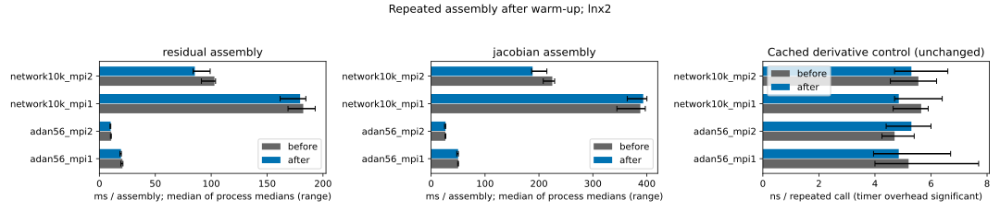
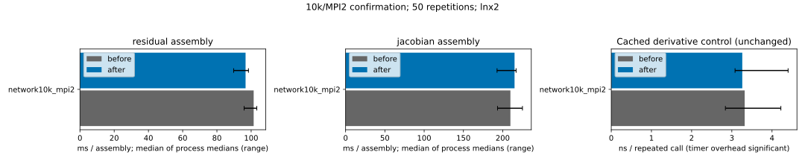

# Gather and scatter residual cell vectors in bulk

Measured baseline `6a4a3b718ca40070aedcda5ec7f4848c02998888`; candidate
`619a48133ce410e26884996dff2c9d08fe1b7ad7`. Both were rebuilt and measured on
**lnx2**, including all four preceding performance interventions.

Cell residual assembly now sends its local vector through the backend's bulk
addition interface. Forming `M*ydot - F` gathers both vectors in bulk and scatters
the resulting cell vector in bulk. Cell/index traversal order, subtraction,
compression and ghost protocols remain unchanged. All cell DoFs are
discontinuous and owned by their cell's rank. This change introduces no cache
or invalidation rule.

## Repeated assembly timings

Five alternating process pairs per case; three samples per process with 20
residual/derivative repetitions and two state-Jacobian repetitions. The graph
shows medians of process medians and their ranges; the table also reports the
median of paired speedups. MPI durations use the slowest rank, core binding,
and one thread per process. GCC 13.2, deal.II 9.8, PETSc, Release with the same
effective flags before/after (`toolchain.json`, final optimization `-O2`).

| Case | Before residual (ms) | After residual (ms) | Median paired speedup | Improved pairs |
|---|---:|---:|---:|---:|
| adan56_mpi1 | 20.612 | 19.298 | 1.074 | 4/5 |
| adan56_mpi2 | 10.564 | 10.044 | 1.041 | 4/5 |
| network10k_mpi1 | 182.341 | 179.546 | 1.044 | 4/5 |
| network10k_mpi2 | 102.904 | 85.370 | 1.084 | 5/5 |

17/20 residual process pairs improved. The state Jacobian and already
cached derivative are controls, with no improvement claimed for them. Cached
derivative calls reach timer/function-call overhead; the graph labels that
control in nanoseconds. The node was busy; before/after load records are
included. This is an assembly result, not an end-to-end solve speedup claim.

The unchanged state-Jacobian control has paired speedups of 1.016, 1.005,
0.986 and **1.206** in the same case order. The last value is a substantial
control shift. Consequently, the 10k/MPI2 residual estimate is confounded and
is not attributed entirely to this patch; the other three cases show residual
benefits distinct from their controls. All original process records and ranges
remain visible, without discarding samples.

## Exact numerical gates

- **54 complete snapshot pairs matched exactly** (1,179,248,416 bytes per side)
  across ADAN56/10k with MPI1/MPI2. Every owned residual entry and every stored
  entry of both Jacobians were compared at three nonuniform states, including
  reversed velocity. Hashes/sizes are in `equivalence.json`.
- **36 additional snapshot pairs matched exactly** for a one-cell case with
  MPI4 and empty ranks (`empty_ranks/equivalence.json`). Those durations are
  not used as performance evidence.
- **32 trajectory CSVs / 2,372 rows matched exactly** for analytic/CSV inflow
  with MPI1/MPI2. Only scaling timings and the wall-time statistics field are
  excluded. Physical times and solver counters remain included. This exercises
  a short 0.01 s case rather than a full cardiac cycle.
- **26 Release tests passed BUILD/RUN/DIFF and CTest**. A single Ninja graph
  built the suite; CTest used `-j1`. The existing cache regression also passed
  MPI2/MPI4, while the separate one-cell snapshots exercise the changed residual
  path with empty ranks.

`metadata.json` records the exact measured binary hashes, input hashes and
revisions. Inputs differ from the preceding campaign only in their private
output directory. `inputs/manifest.json` records unchanged mesh hashes and the
SHA256 of each measured input; deterministic `inputs/*.prm.gz` decompress to
those exact bytes. For example: `gzip -dc inputs/adan56.prm.gz > adan56.prm`.

The measured source matches the root whole-stack audit runtime on every
executable/config/test path (`stack_audit_source_equivalence.json`). Subsequent
report-only rebasing preserves those paths (`runtime_rebase_equivalence.json`).
Full-file clang-format 16 checks are recorded in `formatting_check.json`.
Original logs remain under `build/performance_campaign/lnx2_residual/`; committed
excerpts start at BENCHMARK and retain TimerOutput. `log_excerpt_receipts.json`
records original/excerpt hashes and extraction lines. No numeric timing records
were changed. This report does not claim current-head CI success.

## Predeclared 10k/MPI2 confirmation

The original control shift triggered one confirmation, declared before running
it in `confirmation/protocol.json`: the **same frozen archives and exact input**,
MPI2 only, five complete alternating pairs, **50 repetitions** (three samples
and five state-Jacobian repetitions per sample). No individual samples were
selected or removed. The original campaign remains unchanged; its protected
SHA256 hashes are recorded in `confirmation/original_data_unchanged.json`.

| Experiment | Residual paired speedup | State-Jacobian control | Residual pairs improved |
|---|---:|---:|---:|
| Original, 20 repetitions | 1.0842 | 1.2063 | 5/5 |
| Confirmation, 50 repetitions | 1.0403 | 1.0032 | 3/5 |

Confirmation residual medians were 101.472 ms before and
96.740 ms after. Its five paired ratios were
0.9919, 1.0403, 0.9743, 1.1507, 1.1220.
The control is now close to one, supporting a modest median residual benefit
of approximately 4%, rather than attributing the original 8.4% estimate wholly
to this patch. Two confirmation pairs were slower; variability is retained in
the reported ranges. No statistically precise speedup bound is claimed.

Load averages (1/5/15 min) were [65.67822265625, 66.291015625, 66.5986328125] before and
[66.22119140625, 66.6787109375, 66.734375] after; the exact host/time records are included.
All **18 additional snapshot pairs matched exactly**. No code, archive,
physical input, or numerical tolerance changed for this confirmation.

`confirmation/timings.jsonl`, `confirmation/paired_summary.json`, and the full
log excerpts preserve the complete confirmation alongside the original result.
