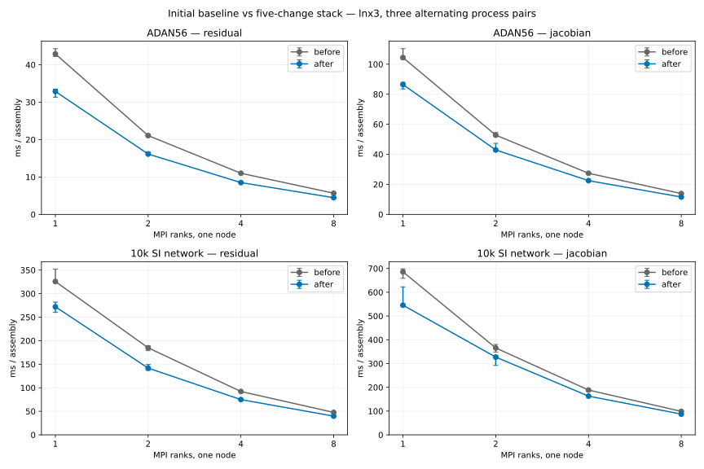
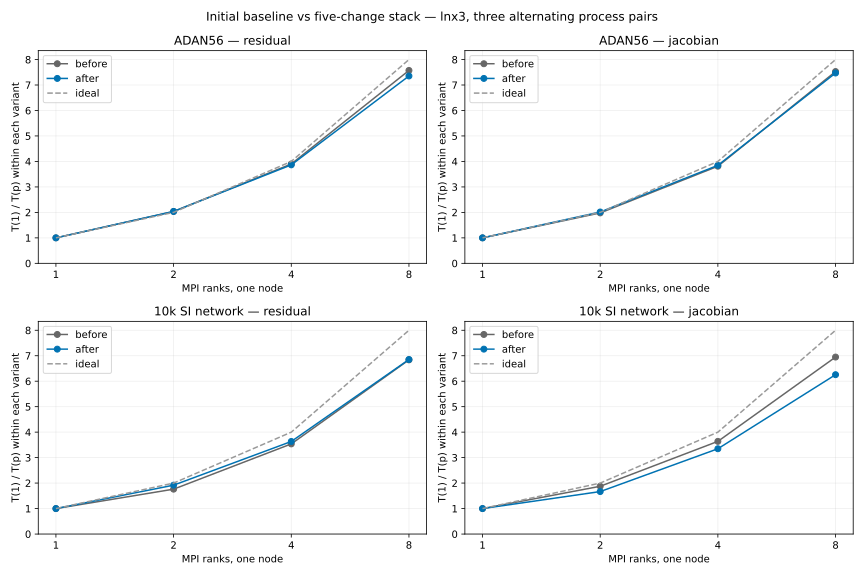

# Cumulative audit: initial baseline versus five interventions

Both archives were compiled and measured on **lnx3** with GCC 13.2, deal.II 9.8,
real PETSc, Release and the same AVX2 toolchain. The configured flags append
`-O2` after the initial `-O3`. The baseline solver is commit
`b5d1b62b576e9d9f471bfd89e0dd2bcc7a7cf714`; it uses the same enhanced benchmark
and snapshot driver as the candidate. The driver's SHA256 on both sides is
`52952ffdc4e80d401823c7b785ff70f8f1d877ebd2ee396156807a53cc3b51d7`.
This driver substitution adds measurement and numerical comparisons to the
baseline; it does not apply the five solver improvements.

The measured candidate is runtime
`27e1ef4db19fa61094b402aea133c5becee228bb`, containing all five interventions
and the declaration-formatting fix. Its executable source, configuration and
test trees match submission runtime
`619a48133ce410e26884996dff2c9d08fe1b7ad7` exactly; see
`audit_source_equivalence.json`; `submission_source_equivalence.json` also
checks the final rebased submission runtime. Binary hashes are in `metadata.json` and
actual dynamic-library resolution is preserved in `loaded_libraries.json`.

## Protocol and scope

This cumulative audit uses **three alternating process pairs**, rather than
the **five pairs used to accept each individual intervention**. Two workloads
run at MPI1/MPI2/MPI4/MPI8 on one node: ADAN56 (2464 cells, 24671 unknowns,
degree 2 with five refinements), and the SI 10k network (20001 cells,
170009 unknowns, degree 1 without refinement). There are 48 timed processes.
Each operation is warmed up, followed by three timed samples per process:
20 residual/derivative repetitions and two state-Jacobian repetitions per
sample. MPI timings use the slowest rank. Processes use one thread and core
binding. `command.json` retains the complete comparison command.

Derivative timings describe repeated calls with a valid cache; first assembly
and cache invalidation are outside the warmed measurement. These after values
reach the cost of a function call and cache check, so no very large derivative
speedup ratio is inferred. `startup_s` is **rank-0 construction/parameter/setup
time only**; it is not the slowest-rank startup time and omits trace bootstrap,
IDA consistency correction, integration and physical output. The audit is an
assembly benchmark, with **no full-solver speedup claim**.

## Latency and paired improvements

The latency plot shows medians of the three process medians, with their
observed minimum/maximum range. These ranges are **not confidence intervals**.
The table instead reports the median of three paired before/after ratios.



| Workload | MPI ranks | Residual paired speedup | State Jacobian paired speedup |
|---|---:|---:|---:|
| ADAN56 | 1 | 1.323 | 1.235 |
| ADAN56 | 2 | 1.298 | 1.218 |
| ADAN56 | 4 | 1.300 | 1.218 |
| ADAN56 | 8 | 1.270 | 1.198 |
| 10k network | 1 | 1.249 | 1.263 |
| 10k network | 2 | 1.335 | 1.143 |
| 10k network | 4 | 1.230 | 1.146 |
| 10k network | 8 | 1.200 | 1.132 |

Absolute residual and state-Jacobian latency improved at every measured rank
count on both workloads. The initial and final times and ranges are retained
in `summary.json` and `scaling_summary.json`; these results are not products
of the separate intervention speedups.

## Strong scaling

For each variant independently, speedup is `T(1)/T(p)` and efficiency is
`T(1)/(p*T(p))`, using the median process times. MPI1 efficiency is 100% by
definition. Small values above 100% at MPI2 can reflect cache and timing variability;
they do not establish a general superlinear scaling guarantee.



| Workload | MPI ranks | Before residual efficiency | After residual efficiency | Before Jacobian efficiency | After Jacobian efficiency |
|---|---:|---:|---:|---:|---:|
| ADAN56 | 2 | 101.8% | 101.9% | 99.0% | 100.8% |
| ADAN56 | 4 | 97.5% | 96.6% | 95.3% | 96.2% |
| ADAN56 | 8 | 94.7% | 91.9% | 94.1% | 93.4% |
| 10k network | 2 | 88.1% | 96.0% | 93.8% | 83.4% |
| 10k network | 4 | 88.5% | 90.9% | 91.0% | 83.7% |
| 10k network | 8 | 85.5% | 85.7% | 86.9% | 78.2% |

At MPI8, the final stack reaches 91.9%/93.4% efficiency for ADAN56
residual/Jacobian and 85.7%/78.2% for the 10k network. The 10k Jacobian has
lower relative efficiency than the baseline despite lower absolute latency
at every rank: its single-rank gain is larger than its eight-rank gain.
Thus this audit demonstrates faster assembly and documents scaling; it does
not establish uniformly improved parallel efficiency or multi-node scaling.

## Exact numerical gates

All **270 complete snapshot pairs match exactly**, covering
**2,361,309,361 bytes per side**. They include every owned residual entry and
every stored entry of both Jacobian blocks at three nonuniform states,
including reversed velocity, on both workloads with MPI1/MPI2/MPI4/MPI8.
Receipts are in `equivalence.json`. Snapshots are outside the timed samples.

Both archives passed the analytic/CSV inflow regression at MPI1/MPI2.
All **32 physical trajectory CSVs / 2372 rows match exactly** in
`trajectory_equivalence.json`, excluding only scaling timings and the
`wall_time` statistics field. Physical times and solver counters remain in
the comparison. These are short 0.01 s trajectories, not full cardiac cycles.
The individual intervention reports contain their separate Release test
results; this cumulative timing audit does not independently claim a new
CTest run or current-head CI result.

## Reproduction and artifact integrity

Raw `metadata.json`, `timings.jsonl`, `summary.json`, `equivalence.json` and
`scaling_summary.json` are unchanged byte copies of the completed audit.
Exact measured parameters are retained as deterministic `inputs/*.prm.gz`;
decompressed SHA256 hashes match `sha256` in `inputs/manifest.json` and the
input hashes in `metadata.json`. Their only change from the preceding
campaign inputs is the private output directory. Mesh paths and hashes are
in the input manifest.

With Matplotlib available, run `python3 plot_scaling.py` to regenerate the
latency and strong-scaling figures and scaling summary. The default `--data`
is the script's own directory, so it works independently of the original
workspace. An explicit `--data DIRECTORY` selects another archive.

Original logs remain in `build/performance_campaign/final_audit/results`.
The 48 report excerpts start at `BENCHMARK` and retain the complete TimerOutput
table. Only trailing whitespace is removed from the excerpts;
`log_excerpt_receipts.json` records original/excerpt hashes and starting lines.
`remaining_costs.md` reviews measured remaining costs, source-backed hypotheses,
solver-lifecycle facts and unmeasured limits against issues #9, #25 and #26.
No sixth intervention is proposed.

```{toctree}
:maxdepth: 1

remaining_costs
```
