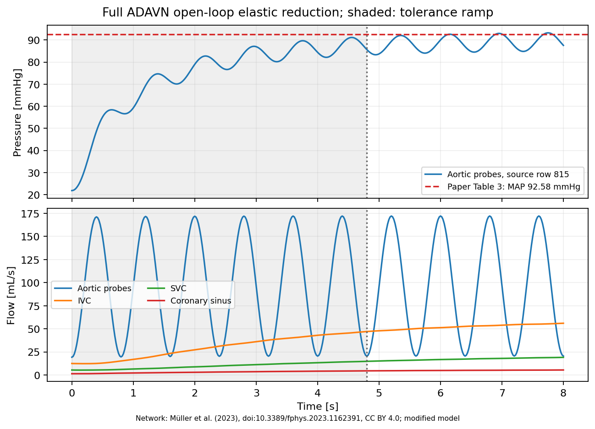
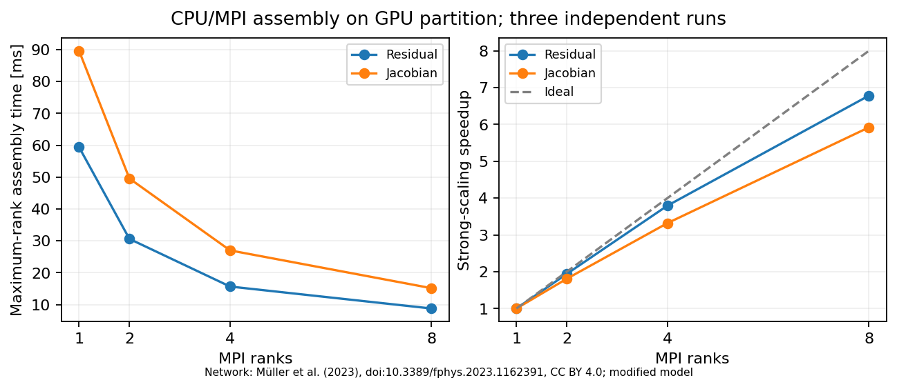

# Full ADAVN arterial–venous network

This tutorial converts **all 4,402 vessel rows** of the supplementary table of
[Müller, Watanabe, Toro, Feijóo and Blanco (2023)](https://doi.org/10.3389/fphys.2023.1162391)
into a connected haemodynamic model: 4,041 arterial and 361 venous segments.
It supplies a native transient HDG calculation, an inexpensive resistive
mean-flow comparison, and a CPU/MPI assembly scaling experiment.

The default creates an **anatomical 1D VTK embedded in 3D**, using the HeMoLab
arterial and venous surface atlases. All **2,184 arterial and 189 venous names**
in the table have matching surfaces. These are anatomical centerline
approximations extracted from surface rings, not the original unpublished
splines or a volumetric mesh for 3D flow.

The full input contains 8,804 straight cells (two per source row), 8,448 points,
and 1,679 resistive connections between arterial and venous endpoints. These
connections couple the four geometrical components through the residual and
Jacobian; they are not extra 1D vessels drawn in the VTK. Original source-row
IDs and lengths are retained. In ParaView, colour by `source_row` for the
4,402 table segments; `vessel_id` denotes the 8,804 computational material IDs.

`recover_full.py` orders split venous chains by connectivity, chooses surface
orientations through global binary least squares, averages shared-node estimates,
and projects node coordinates onto the source chord-length constraints. A bend
near the recovered centerline restores each source segment's exact length. The
coarse two-cell representation can differ visibly from the full surface curve.
In the checked reconstruction, maximum shared-node disagreement is 12.16 mm;
source-length reconciliation moves averaged nodes by at most 3.10 mm. These
are adaptation diagnostics, not guarantees of anatomical accuracy.
The 3.10 mm value concerns shared nodes only. With just two straight cells per
source segment, midpoints of long curved vessels can depart substantially from
the sampled atlas curve: up to 120 mm for the great saphenous vein in this mesh.
This is a coarse anatomical simulation mesh; it does not preserve the full
surface-centerline curvature.

The atlases have separate HeMoLab terms. Run the anatomical workflow only with
the written permission required for your intended use. `ADAVN_ATLAS_PERMISSION=1`
records that confirmation; it does not grant permission. Downloaded surfaces,
anatomical VTKs and anatomical preview images remain local, outside Git.
An explicit `ADAVN_GEOMETRY=metric` alternative reproduces the earlier synthetic
embedding without atlas access; there is no automatic fallback to it.

## Model and comparison with the article

The transient uses the existing `ADAVN mixed` elastic wall model, source arterial
terminal compliances, and peripheral resistances coupled to the actual venous
pressure. Residual venous compartments store the remaining systemic compliance, and
reference characteristic impedances connect them to the 1D venous ends.
The endpoint convention works for both ends of a vessel, including
venous inlets at face zero. Perforating arteries use viscosity 0.001 Pa s;
other vessels use 0.004 Pa s. The VTK `viscosity` cell array overrides the global
viscosity for both the 1D equations and the resistive graph.

The tutorial is an **open-loop reduction** of the article's closed-loop model:

- Inflow is prescribed. Its period is 0.8 s and its mean is 96.36 mL/s
  (Supplementary Table S1 and Table 3). The smooth nonnegative pulse is
  `96.36e-6*(1-0.8*cos(2*pi*t/0.8))` in SI units. This analytic
  waveform is not a reconstruction of the article's ventricular model.
- Three central venous ends drain to a 4.68 mmHg reservoir through small
  1e5 Pa s/m³ resistances. The reservoir pressure and inflow are imposed inputs,
  and must not be counted as independently reproduced results.
- Each source peripheral resistance is split between its listed venous drains
  in proportion to endpoint radius cubed. Parallel conductances preserve the
  source total resistance. Following §2.4.5, arterial R1 is 15% of the source
  total R; the remaining 85% forms the downstream parallel connections. The
  source arterial C is retained. Venous R1 is `rho*c_ref/A_ref`. Residual venous
  compliance is `146 mL/mmHg - sum(volume_vein/(rho*c_ref^2))`; it is distributed
  using the contributing arterial compliances and the same drain weights.
  The mean graph represents both arterial and venous compartments explicitly.
- Venous reference wave speed is explicitly approximated by a constant 2 m/s;
  `prepare_full.py --venous-wave-speed` changes it. The article's radius-dependent
  relation needs additional coefficients not supplied in the vessel CSV.
  Names containing `sinus`, except `coronary_sinus`, select the dural wall law;
  this is an explicit classification assumption.
- Heart/pulmonary closed-loop dynamics,
  venous valves/Starling resistors, intracranial-pressure feedback, coronary
  intramyocardial forcing and Kelvin–Voigt wall viscosity are omitted. The
  general-bed reduction is also applied to coronary ends, rather than the
  article's layered coronary model. Proximal venous impedances are fixed at
  reference geometry rather than changing with the instantaneous area.

The verified resistive calculation predicts **90.4523 mmHg**, compared with
**92.58 mmHg** in Table 3 (relative difference **−2.30%**). The imposed mean
inflow is 96.36 mL/s and reservoir pressure 4.68 mmHg. Aortic pressure is
an independent output. The source is **row 815**,
`A_aortic_arch_C_815`: the paper's vessel index 816 is one-based. The generated
`report.json` records the prediction, relative difference and conservation
checks. A rigid mean-flow match is a reduced-model comparison, not a claim to
reproduce the closed-loop waveforms. The transient's instantaneous pressure
must also not be confused with mean arterial pressure.

## Build and prepare

Use an existing working `build-gpu*` compiler/deal.II environment. The programs
run on the CPU cores of the GPU partition; this workflow does not use CUDA.
A Release build is appropriate for timings. For example:

```sh
cmake -S . -B build-gpu -G Ninja -DCMAKE_BUILD_TYPE=Release \
  -Ddeal.II_DIR="$DEAL_II_DIR" -DCMAKE_CXX_COMPILER="$CXX"
cmake --build build-gpu --target blood_flow adavn_mean_flow benchmark_assembly -j8
python3 -m venv build/analysis-env
build/analysis-env/bin/pip install -r tools/adan/requirements_anatomical.txt
export ADAVN_PYTHON="$PWD/build/analysis-env/bin/python"
export ADAVN_DATA_DIR="$PWD/build/adavn_anatomical"
# Set this only when you hold the required atlas permission.
export ADAVN_ATLAS_PERMISSION=1
tutorials/05_adavn_full/run.sh prepare
"$ADAVN_PYTHON" tools/adan/preview_full.py \
  --vtk "$ADAVN_DATA_DIR/adavn_full.vtk" \
  --output "$ADAVN_DATA_DIR/anatomical_preview.png"
```

The script verifies the archived CSV and all 2,373 atlas surfaces against the
pinned checksums, then creates `adavn_full.vtk`, `connections.csv`, graph CSVs,
`mapping.json`, `geometry_report.json`, `provenance.json` and rendered parameter
files under `ADAVN_DATA_DIR` (default `build/adavn_full`). NumPy and SciPy are
required for anatomical reconstruction; the mean analysis itself uses the
standard library. Inspect the preview or the VTK in ParaView before simulation.
A missing or changed surface is an error, rather than a synthetic substitute.

`mapping.json` maps every original row to its two cell/material IDs, `2*row`
and `2*row+1`. Names alone are not identifiers: the published venous table has
repeated names. The conversion preserves original node IDs, all rows and the
source taper. It fails on an altered source checksum or missing peripheral
connections. `provenance.json` records input digests, units and model reductions.

## Ten-cycle transient

```sh
export OMP_NUM_THREADS=1 OPENBLAS_NUM_THREADS=1 MKL_NUM_THREADS=1 DEAL_II_NUM_THREADS=1
ADAVN_BLOOD_FLOW_EXECUTABLE="$PWD/build-gpu/blood_flow" \
  tutorials/05_adavn_full/run.sh transient
```

The generated `$ADAVN_DATA_DIR/transient.prm` is a complete parameter file.
Its template is [hdg.prm.in](hdg.prm.in). Run it in a serial Slurm task with the
same environment as the build. The example uses a direct solver; a serial
UMFPACK build is sufficient. MPI time integration with a direct solver needs a
compatible parallel solver such as MUMPS. With the PETSc backend, native
deal.II MUMPS (deal.II 9.7 or newer) is also supported when PETSc itself lacks
MUMPS; keep
`Use direct solver = true`. MPI assembly benchmarking does not
need such a factorization.

To repeat the prepared case on 32 CPU cores, copy `transient.prm` to a new
run directory and change its `Output directory` to a fresh absolute path there.
Keep `Use direct solver = true` and the physical and time-integration settings.
With a working parallel MUMPS build, submit from the repository root:

```sh
export ADAVN_BLOOD_FLOW_EXECUTABLE="$PWD/build-gpu-mumps/blood_flow"
export ADAVN_PARAMETERS="$PWD/build/adavn_anatomical_mpi32/parameters.prm"
export MPIEXEC=/path/to/matching/openmpi/bin/mpiexec
sbatch --output="$PWD/build/adavn_anatomical_mpi32/run.log" \
  tutorials/05_adavn_full/run_transient_mpi.sbatch
```

The script requests 32 MPI ranks on one node, one thread per rank, with core
binding. It runs an existing parameter file and writes to its configured output
directory. Validate the installed MUMPS stack at runtime before benchmarking:
MUMPS integer width is independent of deal.II global index width. The native
wrapper currently requires at least one owned DoF per rank; the driver reports
this restriction before solving. Use fewer ranks, PETSc MUMPS or the iterative
solver for cases with empty ranks. The full network satisfies this requirement
at 32 ranks.

The transient uses degree two, HLL_HDG flux and the coupled resistive graph
as its initial seed. Degree two represents the linearly tapered reference radius
without the initial quadratic-area interpolation error of degree one. The
Newton convergence coefficient is 1e-4, keeping the nonlinear solve accurate
during the deliberately loose startup.

The final time is **8 s, exactly ten cardiac cycles**. The existing tolerance
ramp is deliberately very loose for startup: relative and component absolute
tolerances are multiplied by 100 for 2.4 s (three cycles), then tightened
geometrically through 4.8 s. **Cycles seven through ten use the final tolerances**:
relative 1e-5, area absolute fraction 1e-6, velocity 1e-6 m/s and capacitor
pressure 0.01 Pa. Output every 0.02 s gives 40 output intervals per cycle;
IDA adapts its own internal steps. Inspect the ramp fields in `initialization_statistics.json`, the native IDA
statistics and the actual final output time before accepting a run.

Use the two independent midpoint probe parameters:

```text
set Output vessel CSV file = probes.csv
set Vessel probe IDs = 1630, 1631, 8298, 8299, 8574, 8575, 8696, 8697
```

This writes **one file** with columns
`time_s,vessel_id,pressure_Pa,flow_m3_s,area_m2,velocity_m_s`.
An empty filename disables vessel probes. With a nonempty filename, an empty
ID list selects every vessel. There are no `all` or `none` keywords. These
IDs select the aortic source row and the three central venous drainage rows.
The independent `Output terminal CSV file = terminals.csv` writes the shared
terminal table; it does not create per-section probe files.

After successful completion, compare cycles seven through ten and report the
cycle-ten versus cycle-nine differences for every selected probe:

```sh
"$ADAVN_PYTHON" tools/adan/analyze_cycles.py --run-dir "$ADAVN_DATA_DIR/transient_10cycles"
```

This requires all 401 output times and a completed solver receipt with final
ramp factors equal to one. `cycle_report.json` distinguishes a cycle average
from instantaneous pressure and reports periodicity rather than assuming it.

The connected input VTK and native `adavn_full.pvd`/PVTU/VTU results can be
opened in ParaView. Native HDG output retains discontinuities. To export the
last completed native result on the connected source geometry:

```sh
"$ADAVN_PYTHON" tools/adan/export_full_result.py \
  --data-dir "$ADAVN_DATA_DIR" \
  --run-dir "$ADAVN_DATA_DIR/transient_10cycles" \
  --output "$ADAVN_DATA_DIR/arteries_veins_hdg.vtk"
```

The exporter requires the expected final time (8 s by default) and exactly
one completed native solver receipt, checks coverage and
positive area, and writes a JSON receipt with source and output hashes.
Its cell fields are endpoint averages; use the native VTU for detailed fields.
Do not use a failed run's partial snapshots as a completed ten-cycle result.

## Resistive mean and initial-state graph

```sh
ADAVN_MEAN_EXECUTABLE="$PWD/build-gpu/adavn_mean_flow" \
  tutorials/05_adavn_full/run.sh mean
ADAVN_BLOOD_FLOW_EXECUTABLE="$PWD/build-gpu/blood_flow" \
  tutorials/05_adavn_full/run.sh graph
```

The first command invokes the native `solve_steady_network` on 5,622 hydraulic nodes and
7,657 edges (including 1,576 lumped compartments), checks conservation independently, compares the aortic pressure,
and writes **`$ADAVN_DATA_DIR/arteries_veins_mean.vtk`** with pressure and flow.
The second uses the application's `steady network` mode and reconstructs its
seed on the full 1D mesh; it does not advance IDA or solve the compliant HDG
steady equations. A graph seed can be useful, but is not automatically a
consistent full-network transient state.

## Efficiency experiment

Inside an eight-core Slurm allocation, with the MPI launcher matching the
compiler used for the build:

```sh
"$ADAVN_PYTHON" tools/adan/benchmark_full.py \
  --executable build-gpu/benchmark_assembly --launcher "$MPIEXEC" \
  --parameters "$ADAVN_DATA_DIR/assembly.prm" \
  --output-dir "$ADAVN_DATA_DIR/performance" \
  --launcher-arg=--bind-to --launcher-arg=core
```

This measures 1, 2, 4 and 8 MPI ranks, with three independent runs in alternating
order. Each run warms up and measures three batches: 20 residual/mass evaluations
and two Jacobian evaluations per batch. The deterministic synthetic state has
cell and trace area `1.01*A_ref_midpoint`, velocity 0.1 m/s, capacitor pressure
zero and state derivatives 0.02. It is a common assembly input across partitions,
rather than an accepted transient solution. Assembly
samples use the maximum rank time; the script reports medians, strong-scaling
speedup and efficiency, verifies residual norms across decompositions, and
records hardware, affinity, build/input hashes and per-rank cell/timing counts.
The derivative benchmark measures the cached elastic mass-matrix path. These
are CPU/MPI assembly results, not end-to-end IDA or GPU acceleration timings.
The direct factorization and startup costs require separate interpretation.
To regenerate the scientific figures after the run and benchmark:

```sh
"$ADAVN_PYTHON" tools/adan/plot_full.py \
  --run-dir "$ADAVN_DATA_DIR/transient_10cycles" \
  --performance-dir "$ADAVN_DATA_DIR/performance" \
  --output-dir "$ADAVN_DATA_DIR/figures"
```

This exports PNG and vector PDF figures of pressure/flow, accepted internal
steps/Newton work, and MPI assembly scaling.

[run_gpu.sbatch](run_gpu.sbatch) combines build, preparation, mean, transient and
assembly experiments. Submit from the repository root with `DEAL_II_DIR`, `CXX`
and `MPIEXEC` exported from a known working GPU configuration. Adjust the Slurm
allocation to the local cluster and keep each execution's output directory
separate.

## Verified anatomical execution

The atlas-derived input was independently read with meshio and checked against
the earlier metric input: connectivity, material IDs and all physical fields
are identical, with maximum relative cell-length error 8.13e-13. The anatomical
preview and generated meshes remain local under the atlas terms.

The anatomical run completed all ten cycles to **8 s**, with **1,005 IDA steps**,
6,036 Newton iterations and final ramp factors one. Integration took **751.64 s**
on one CPU core of the GPU partition. Cycle-ten MAP was **89.0727 mmHg** and
mean aortic probe flow **96.3476 mL/s**. The final sampled area is positive
throughout (minimum 4.0222e-9 m²). These results agree with the metric run to
the reported precision, as expected when the physical metric is preserved.
They retain the model limitations and incomplete periodic relaxation discussed
below. The local output paths are `build/adavn_anatomical/adavn_full.vtk` for
the input and `build/adavn_anatomical/arteries_veins_hdg.vtk` for the completed
result; the tutorial commands regenerate them in `ADAVN_DATA_DIR`.

A separate **32-rank anatomical run** on a multicore server completed the same ten cycles
with native deal.II MUMPS (LP64), one thread per rank and core binding:

| CPU cores | Direct solver | Integration time |
| --- | --- | --- |
| 1 | UMFPACK | 751.64 s |
| 32 | Native deal.II MUMPS | 130.42 s |

The observed speedup is **5.76×**; the complete parallel process took **140.73 s**.
Both runs took exactly 1,005 steps and 6,036 Newton iterations, with 401 output
times and final tolerance ramp factors one. Across all 3,208 probe rows, maximum
pressure difference was 5.46e-11 Pa and maximum flow difference 3.28e-18 m³/s.
The solver and dependency builds differ and the node was shared, so this is an
observed end-to-end comparison, not a controlled strong-scaling experiment.
The parallel root timer attributes 39.06 s (29.7%) to output and 39.58 s (30.1%)
to linear solves. Writing the unchanged 401 snapshots creates 12,832 VTU pieces;
output therefore remains a substantial cost at 32 ranks.

The separate local result is
`build/adavn_anatomical_mpi32/arteries_veins_hdg.vtk`, with native time-series
files under `build/adavn_anatomical_mpi32/output/`. A portable summary is in
[anatomical_mpi32_performance.json](reference/anatomical_mpi32_performance.json).
The LP64 stack passed ten arterial/venous elastic/viscoelastic native/IDA
integration cases at one and two ranks. The empty-rank rejection was separately
verified; the native wrapper's empty-rank result-copy defect is not bypassed
silently. The supported-layout check is reproducible with
`python3 tests/test_wall_integration.py --executable build-gpu-mumps/blood_flow --mpi --mpi-ranks 1 2`.
The older 64-bit-MUMPS installation stalled in the two-rank runtime
check; compilation alone did not establish that installation's usability.

## Verified synthetic-metric reference execution

The published snapshots in this section used the explicit **metric geometry**
mode, before the anatomical workflow was integrated. They contain no atlas
coordinates and must not be presented as an anatomical simulation receipt.
To reproduce that geometry, set `ADAVN_GEOMETRY=metric` and a fresh data directory.
The anatomical workflow above retains the same topology, source lengths,
material IDs and physical parameters; its execution gets separate local receipts.


The [reference snapshots](reference/) were generated on 27 October 2026 on
a server with AMD EPYC 7763 CPUs, using a CPU-only Slurm allocation. The serial
transient and the exclusive-node MPI benchmark are separate measurements.
The build reused the working `build-gpu` OpenMPI 5.0.10/deal.II 9.8.0 Spack
installation, PETSc backend, `-Wno-cpp`, and a DebugRelease build's Release
executable. Direct serial solves used UMFPACK; this installation has no PETSc
MUMPS support. These original reference runs predate the native deal.II MUMPS
fallback and did not measure end-to-end MPI integration speedup.

All 4,402 rows are present in the final connected VTK. The quadratic HDG system
has **8,804 cells and 89,616 DoFs**, including 1,576 compartment pressures.
The run completed **1,005 IDA steps**, 6,036 Newton/linear-solve iterations,
13 Jacobian setups, one error-test failure and one nonlinear-convergence failure.
Integration took **749.49 s** on one CPU core; native preparation took 1.79 s.
The final native sampled area is positive everywhere (minimum 4.0222e-9 m²).
A fresh conversion reproduces every consumed input digest exactly.

| Cycle | Aortic mean pressure [mmHg] | Mean aortic probe flow [mL/s] |
| --- | ---: | ---: |
| 7 | 87.7583 | 96.3186 |
| 8 | 88.3855 | 96.3335 |
| 9 | 88.7940 | 96.3423 |
| 10 | 89.0727 | 96.3476 |

Cycle-ten MAP differs from Table 3 by **−3.79%**. Its mean is still 0.2788 mmHg
above cycle nine; the largest phase-aligned aortic pressure difference is
0.3346 mmHg. The central venous probe flows sum to about 79.18 mL/s over cycle
ten, while imposed mean inflow is 96.36 mL/s: the compliant system is still
storing blood. **Stopping after ten cycles does not establish a periodic state.**
The 90.4523 mmHg resistive prediction and the ten-cycle transient are therefore
reported separately. The prescribed pulse also does not reproduce the paper's
systolic/diastolic waveform (110.1/71.82 mmHg).

The final-cycle mesh-volume change differs from the trapezoidal integral of
all physical mesh-boundary fluxes by −0.0896 mL/s, or −0.0930% of imposed mean
flow. This check includes exchanges with lumped compartments and uses 0.02 s
samples; it is not an exact discrete residual identity or a spatial convergence
study. Pointwise finite-difference volume diagnostics can have larger defects.



| MPI ranks | Residual [ms] | Jacobian [ms] | Residual speedup | Jacobian speedup |
| --- | ---: | ---: | ---: | ---: |
| 1 | 59.40 | 89.63 | 1.00 | 1.00 |
| 2 | 30.61 | 49.57 | 1.94 | 1.81 |
| 4 | 15.65 | 27.00 | 3.79 | 3.32 |
| 8 | 8.76 | 15.14 | 6.78 | 5.92 |

At eight ranks, residual and Jacobian parallel efficiencies are **84.8%** and
**74.0%**. Residual norms agree across all runs/layouts within 1.83e-15
relative spread. Owned-cell counts differ by at most one cell (1,100 or 1,101 at eight
ranks); ghost counts range from 11 to 102. The increasing communication/junction
share limits scaling despite good cell balance. This is an interpretation of
these timings and partition counts, not an MPI communication profile.

The serial transient spends about 51% of integration wall time assembling
residuals, 31% in linear solves, 10% checking wall admissibility, and 2.7% setting
up/factorizing Jacobians. Nested timers must not be added together. Faster
assembly alone cannot deliver the same end-to-end speedup: factorization,
back-solves, checks and I/O remain part of the run. The cached mass-matrix
benchmark is only a few nanoseconds per no-op reuse and is not a useful claim
about fresh mass assembly performance.



The [cycle report](reference/cycle_report.json), [resistive result](reference/mean_flow.json),
[MPI receipt and samples](reference/cpu_mpi_scaling.json),
[raw assembly logs](reference/assembly_logs/), probe/step CSVs and PDF figures
are included for inspection. `executed_parameters.prm` is the exact execution
receipt and contains local absolute paths; use the portable templates and
`run.sh` to generate your own input. The runner refuses an existing transient
output directory so receipts from separate runs cannot be appended together.

## Attribution

Source data and derived geometry: Müller et al. (2023),
[doi:10.3389/fphys.2023.1162391](https://doi.org/10.3389/fphys.2023.1162391),
[CC BY 4.0](https://creativecommons.org/licenses/by/4.0/). Changes: full CSV
extraction, SI conversion, metric or surface-derived anatomical embedding, two-cell subdivision, adapted
terminal/wall parameters and simulation result fields. No author endorsement
is implied. The programs are covered by the repository MIT license; that
license does not replace the data attribution. See [source documentation](../../doc/adan_complete.md)
for the archived CSV, source digest and article/supplement links. Generated
large data remain outside Git and are reproducible with the supplied scripts.

Anatomical surface data and geometry have **separate HeMoLab terms**, documented
at http://hemolab.lncc.br/adan-web/doc/Terms.html. The article's CC BY license
does not replace those terms. The venous catalogue is
http://hemolab.lncc.br/adan-web/ADAVN.json; surfaces are in `MESHES/venous/`.
`tools/adan/sources.json` pins the catalogue and every venous surface digest.
